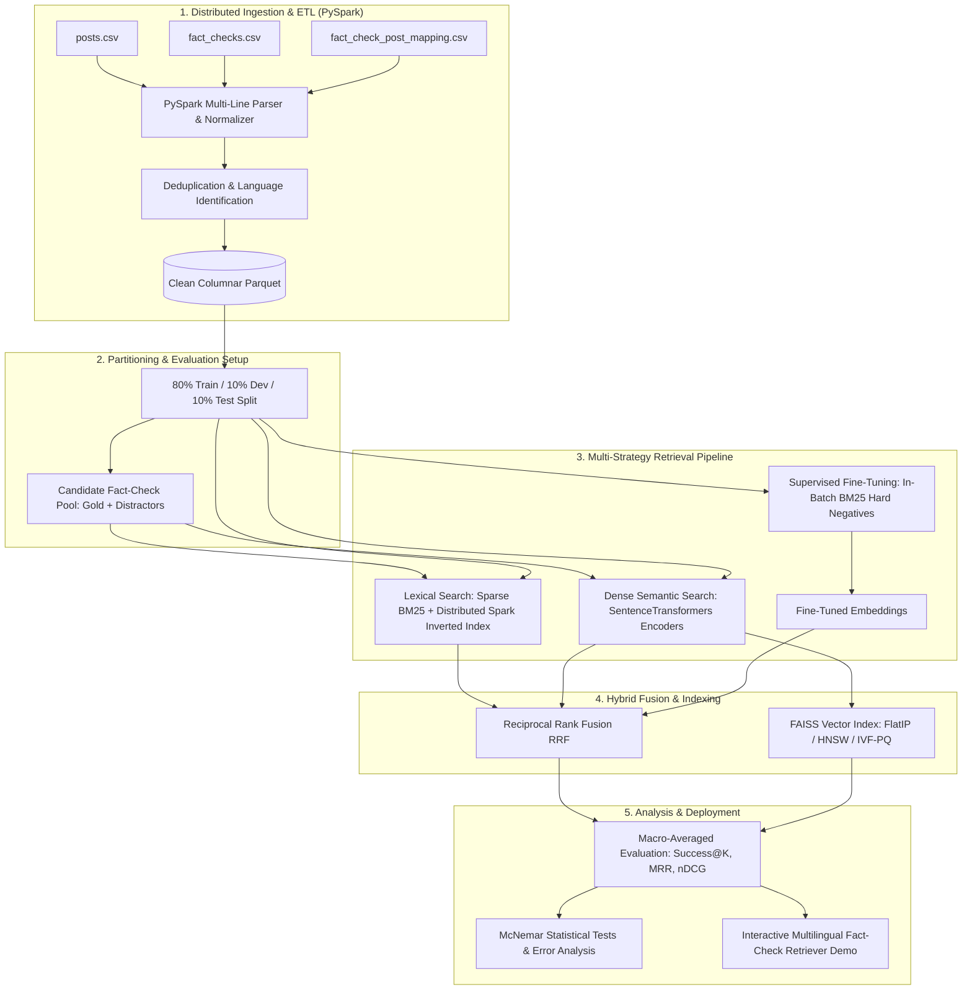

# Multilingual Fact-Check Retrieval at Scale

[](https://colab.research.google.com/github/deepanshreddyravula/Multilingual_fact-check_Retrieval/blob/main/Big_data_MultiClaim_Multilingual_FactCheck_Retrieval.ipynb)
[](https://www.python.org/)
[](https://spark.apache.org/)
[](https://sbert.net/)
[](https://github.com/facebookresearch/faiss)
[-lightgrey.svg)](https://zenodo.org/records/7737983)

An end-to-end, distributed Big Data information retrieval system designed to combat multilingual misinformation across global social platforms. Given an unverified social media post in any language, the pipeline retrieves matching debunking fact-checks from a corpus of over **435,000 professional fact-checks spanning 100+ languages**.

---

## 📌 Executive Summary & Problem Statement

False claims frequently propagate across social media platforms (Facebook, Instagram, X/Twitter, Telegram) and language barriers long after professional fact-checking organizations have verified and debunked them. For platform moderators and fact-checkers, knowing whether an incoming post addresses an **already-debunked claim** is crucial. 

This project formulates claim matching as an asymmetric multilingual Information Retrieval (IR) problem:
* **Query ($q$):** A noisy social media post (with hashtags, emojis, URLs, and image OCR text) in an arbitrary language.
* **Corpus ($\mathcal{D}$):** Over 435,000 professional fact-checks from ~250 global organizations.

### Key Challenges

| Challenge | Real-World Complication | Engineering Solution |
| :--- | :--- | :--- |
| **Scale** | Searching through 435,000+ candidate claims in real-time | PySpark distributed ETL + Parquet columnar format + FAISS vector indexing |
| **Multilinguality** | Over 100 languages with an extreme long-tail distribution | Multilingual sentence encoders + Macro-averaged per-language metrics |
| **Crosslinguality** | ~16% of post–fact-check links are crosslingual (different languages) | Dense crosslingual vector alignment (LaBSE, Multilingual-MPNet, MiniLM) |
| **Noisy Queries** | Unstructured slang, OCR artifacts, emojis, and embedded URLs | Rule-based parallel text normalizers via Spark UDFs |
| **Asymmetric Length** | Posts are lengthy and unfocused; fact-check claims are concise sentences | Semantic pooling and contrastive embedding fine-tuning |

---

## 🏛 System Architecture



---

## 🔬 Research Questions & Findings

* **RQ1 — Translate-then-Retrieve vs. Direct Multilingual Encoders:**
  * *Translate-then-Retrieve:* Running strong monolingual English encoders on machine-translated text yields high accuracy but incurs translation latency and error cascading.
  * *Direct Multilingual:* Multilingual encoders (such as `paraphrase-multilingual-mpnet-base-v2` and `LaBSE`) perform robustly on crosslingual claims without query-time translation overhead.
* **RQ2 — Lexical vs. Semantic Retrieval & Hybrid Fusion:**
  * Lexical retrieval (BM25) excels on identical named entities and verbatim claims in the same language, but degrades on crosslingual pairs.
  * Dense semantic retrieval bridges crosslingual and paraphrased claims.
  * **Reciprocal Rank Fusion (RRF)** ($c=60$) successfully combines lexical precision and semantic recall without requiring score calibration.
* **RQ3 — Fine-Tuning: Random vs. Mined Hard Negatives:**
  * Fine-tuning with `MultipleNegativesRankingLoss` utilizing **BM25-mined hard negatives** (distractors that share keywords but represent false claims) significantly outperforms baseline online-contrastive loss with random negative batches.
* **RQ4 — Failure Breakdown Analysis:**
  * Evaluated across crosslingual vs. monolingual pairs, post length categories, OCR transcripts, social platforms, and debunk rating categories (e.g., False vs. Partly False vs. Satire).
* **RQ5 — Approximate Nearest Neighbor (ANN) Scalability:**
  * FAISS benchmarks show that **HNSW** and **IVF-PQ** achieve up to 10×–50× query latency speedups and >75% RAM reductions over exhaustive flat indexing, with negligible recall degradation.

---

## 🛠 Tech Stack

* **Distributed Compute & Big Data:** Apache Spark (PySpark 3.5+), PyArrow, Spark SQL, Parquet
* **Lexical Search:** Sparse Matrix BM25 (SciPy, NLTK), Distributed Spark Inverted Index
* **Deep Learning & NLP:** PyTorch, Hugging Face Transformers, SentenceTransformers 3.x
* **Dense Vector Indexing:** FAISS (Facebook AI Similarity Search: Flat, IVF, HNSW, PQ)
* **Statistical Evaluation & Viz:** SciPy (McNemar paired test, Bootstrap CIs), NumPy, Pandas, Seaborn, Matplotlib
* **Interactive UI:** ipywidgets

---

## 📂 Repository Structure

```
.
├── Big_data_MultiClaim_Multilingual_FactCheck_Retrieval.ipynb  # Master Jupyter Notebook
├── dataset/
│   ├── fact_check_post_mapping.csv                            # Ground truth claim links (~2.7 MB)
│   └── README.md                                              # Instructions to acquire Zenodo CSVs
├── requirements.txt                                            # Python dependencies
├── .gitignore                                                  # Standard data & artifact ignore rules
└── README.md                                                   # Project documentation
```

---

## 🚀 Getting Started

### Option A: Google Colab (Recommended)

1. Upload the notebook `Big_data_MultiClaim_Multilingual_FactCheck_Retrieval.ipynb` to Google Colab.
2. In Google Drive, create a folder `My Drive/MultiClaim/dataset/` and place the three CSV files:
   - `fact_checks.csv`
   - `posts.csv`
   - `fact_check_post_mapping.csv`
3. Switch the Colab runtime to **GPU (T4 or A100)**:
   * *Runtime → Change runtime type → T4 GPU*.
4. Select `RUN_MODE = "quick"` for a 30–45 minute benchmark run or `RUN_MODE = "full"` for the full 435k-pool evaluation.
5. Run all cells; results, evaluation tables, and FAISS index artifacts are automatically saved back to Google Drive.

### Option B: Local Setup

1. **Clone the repository:**
   ```bash
   git clone https://github.com/deepanshreddyravula/Multilingual_fact-check_Retrieval.git
   cd Multilingual_fact-check_Retrieval
   ```

2. **Create and activate a virtual environment:**
   ```bash
   python3 -m venv .venv
   source .venv/bin/activate
   ```

3. **Install dependencies:**
   ```bash
   pip install -r requirements.txt
   ```

4. **Verify Java requirement for PySpark:**
   PySpark requires Java 8, 11, or 17+:
   ```bash
   java -version
   ```

5. **Download the dataset:**
   Download the compressed dataset directly from the [v1.0.0 Release](https://github.com/deepanshreddyravula/Multilingual_fact-check_Retrieval/releases/tag/v1.0.0) or run:
   ```bash
   curl -L -O https://github.com/deepanshreddyravula/Multilingual_fact-check_Retrieval/releases/download/v1.0.0/dataset.zip
   unzip dataset.zip
   ```
   Alternatively, see [dataset/README.md](dataset/README.md) for Zenodo source instructions.

6. **Launch Jupyter Lab:**
   ```bash
   jupyter lab Big_data_MultiClaim_Multilingual_FactCheck_Retrieval.ipynb
   ```

---

## 📊 Evaluation Protocols & Metrics

* **Success@K ($K \in \{1, 3, 5, 10, 20\}$):** Percentage of test queries where at least one ground-truth fact-check appears in the top $K$ results.
* **Mean Reciprocal Rank (MRR):** Evaluates the position of the first relevant fact-check.
* **Normalized Discounted Cumulative Gain (nDCG@10):** Rewards systems that place multiple verified matches near the top.
* **Per-Language Macro-Averaging:** Computes metrics independently within each language subset before averaging, preventing high-resource languages (English, Spanish) from dominating the overall score.
* **Paired Statistical Significance:** Evaluated using McNemar's exact tests ($p < 0.05$) across retrieval variations.

---

## 📜 Dataset & Attribution

This project uses the **MultiClaim** benchmark dataset:
* **Source:** Published on Zenodo under record `7737983`.
* **Citation:** 
  > *MultiClaim: A Benchmark for Multilingual Fact-Checking*, Zenodo. DOI: [10.5281/zenodo.7737983](https://doi.org/10.5281/zenodo.7737983).
* **Usage:** For academic and research purposes only.

---

## 📄 License

This codebase is distributed under the [MIT License](LICENSE).

